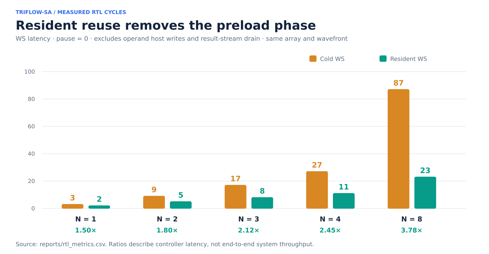
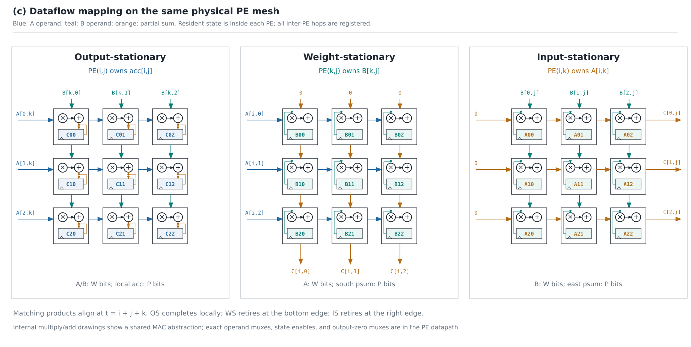
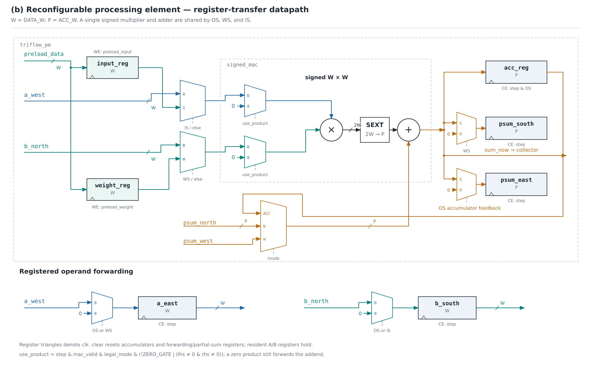
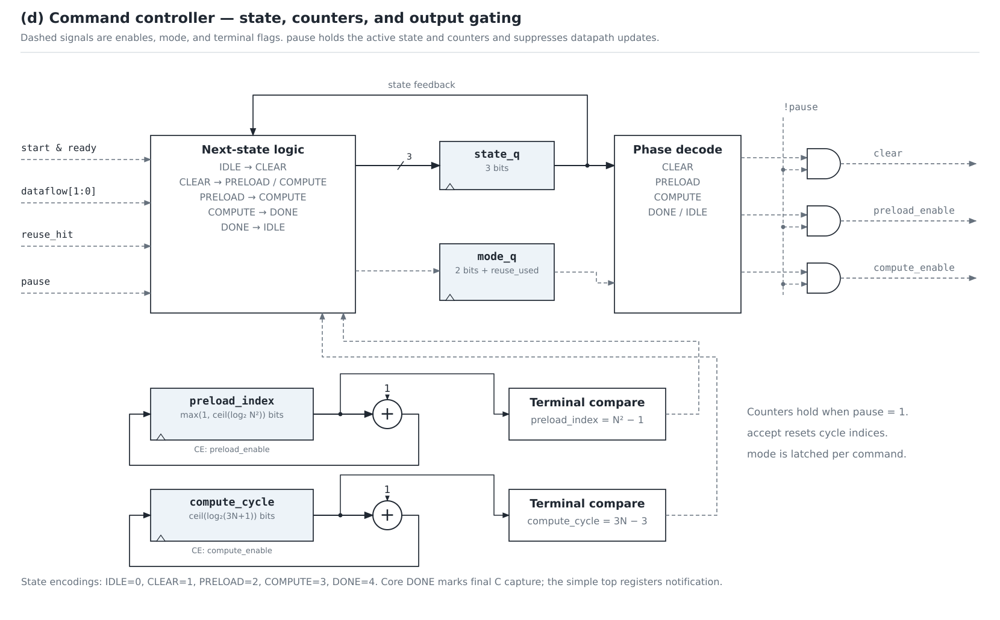
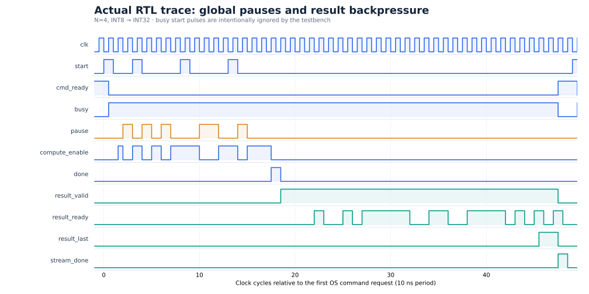

# TriFlow-Systolic-Array

**One systolic fabric. Three runtime dataflows. One shared MAC per PE.**

[](https://github.com/matinfirooz/TriFlow-Systolic-Array/actions/workflows/ci.yml)


TriFlow-SA is a parameterized signed-integer `N × N` matrix-multiplication
accelerator. The same PE mesh executes **output-stationary (OS)**,
**weight-stationary (WS)**, and **input-stationary (IS)** mappings selected at
runtime. This version adds shared arithmetic, safe resident-operand reuse,
atomic pause/resume, and a result stream with backpressure. The original
`triflow_top` host port names remain available.

The included hardware operates on one square tile, `C = A × B`. A Python tile
driver demonstrates rectangular GEMM and ragged-edge padding using the same
mapping. It performs host-side orchestration and accumulation.

## Architecture


The diagram is an editable SVG; [PNG](assets/architecture.png) and a
[generator](scripts/make_figures.py) are included.

The architecture figures now use hardware schematic symbols: explicit clocked
registers, muxes, multiply/add datapaths, feedback loops, bus widths, and dashed
control wires. Six circuit views cover the full design:

| Hardware view | Figure |
| --- | --- |
| Top-level datapath and control | [architecture.svg](assets/architecture.svg) |
| Shared-MAC PE and forwarding registers | [pe.svg](assets/pe.svg) |
| OS / WS / IS mapping | [dataflows.svg](assets/dataflows.svg) |
| Controller registers and pause gates | [control_timing.svg](assets/control_timing.svg) |
| Collector, C storage, and result drain | [result_path.svg](assets/result_path.svg) |
| Registered inter-PE operand/partial-sum links | [array_links.svg](assets/array_links.svg) |

See the [hardware figure guide](docs/figures.md) for signal conventions,
RTL register mapping, editable sources, and every SVG/PNG pair.

## What changed

| Uploaded project | Updated implementation |
| --- | --- |
| Three separate mode-specific multipliers/adders in each PE | Operand/addend muxes feed one shared `signed_mac` |
| Stationary operand preloaded on every WS/IS job | Independent A/B residency flags; safe reuse on request |
| PEs update outside the compute phase | Explicit global compute step; pause freezes links and collection together |
| One top-level testbench | A dedicated testbench for every RTL module/package plus an expanded regression |
| Mixed procedural/module drivers on mesh links fail Icarus elaboration | Single-driver net interconnect, tested with Icarus and Verilator |
| Initialization-only operand buffer | Explicit reset, bounded reads/writes, guarded host access |
| Unused single-write result-buffer module | Integrated multiwrite result bank for wavefront retirement |
| Direct result read only | Direct read plus optional row-major ready/valid result streaming |
| Informal cycle estimates | Actual RTL CSV measurements, counters, trace, and reproducible reports |

**No arithmetic approximation is used.** INT4 and INT8 are elaboration-time
configurations of the same RTL, not a runtime precision switch.

## Start here

Software and reference-model tests require only Python 3.10+:

```bash
python3 -m unittest discover -s tests -v
python3 sw/golden.py
python3 sw/tiled_gemm.py
```

For full RTL verification on Ubuntu, Debian, or Ubuntu under WSL:

```bash
sudo apt-get update
sudo apt-get install -y python3 make g++ iverilog verilator yosys
make test
```

A quick RTL run needs Icarus only:

```bash
make sim
# Equivalent:
python3 scripts/run_tests.py --quick
```

From Windows PowerShell, enter WSL before running `make` and the Linux tools:

```powershell
wsl
```

Then `cd` to the extracted project, for example:

```bash
cd /mnt/c/Users/surface/Downloads/TriFlow-SA
make test
```

The full regression uses Verilator for `N=1`, because Icarus 12.0 crashes
when elaborating a singleton unpacked-array port. The `N≥2` cases use Icarus.
Both simulators are used on the default extended core as an additional check.
Tool paths can be overridden with the `IVERILOG`, `VVP`, `VERILATOR`, and
`YOSYS` environment variables.

## Verified results

The included [verification report](reports/verification.json) records **29
passing RTL configurations**, with **795 self-checking GEMM transactions** in
the extended-core sweeps. Unit benches separately check arithmetic, buffers,
scheduling, control, residency, retirement, streaming, and counters.
[Six Python test methods](tests/test_model.py) include 240 register-wavefront
comparisons with an independent mathematical GEMM oracle.

| Check | Result in this package |
| --- | --- |
| Main RTL regression | 29 passed, 0 failed |
| Default core simulated independently with Verilator | Passed |
| Strict Verilator RTL lint | No warnings at N=1, 3, 4, 8 and on the legacy wrapper |
| Python reference / rectangular tiling | Passed |
| Yosys generic PE operator check | 1 multiplier + 1 adder; uploaded PE had 3 + 3 |

These are simulator and generic RTL structure results. The package does not
claim a measured ASIC/FPGA frequency, area, power, or energy benefit. Sharing
arithmetic adds selection logic, and zero isolation can add overhead; mapped
implementation is needed to quantify the tradeoff.

### Controller latency

With no pauses, all modes execute `N³` useful MACs over `3N − 2` compute steps.
WS/IS need `N²` preload steps on a cold run. A valid reuse hit removes them.
Every command also has one clear step.

| N | Compute steps | Cold WS/IS cycles | Reused WS/IS cycles | Preload cycles saved |
| ---: | ---: | ---: | ---: | ---: |
| 1 | 1 | 3 | 2 | 1 |
| 2 | 4 | 9 | 5 | 4 |
| 3 | 7 | 17 | 8 | 9 |
| 4 | 10 | 27 | 11 | 16 |
| 8 | 22 | 87 | 23 | 64 |

The measurements exclude host operand writes and result-stream drain. The
legacy wrapper registers its `done` pulse one clock after the core's matrix
completion; this notification clock is also excluded from the counters.
The minimum unpaused result-stream drain is `N²` handshakes plus its launch
boundary. There is one C bank, so a new job waits until a requested stream
finishes. Operand host writes may overlap that drain.



Sources: [RTL measurements](reports/rtl_metrics.csv),
[latency summary](reports/reuse_latency.csv), and
[PE structure check](reports/pe_structure.json).

## Three dataflows



| Mode | Code | Physical PE owns | Operand motion | Partial-sum destination |
| --- | ---: | --- | --- | --- |
| OS | `2'd0` | `C[i,j]` accumulator | A east, B south | Local accumulator |
| WS | `2'd1` | `B[k,j]` weight | A east | South, final result at bottom edge |
| IS | `2'd2` | `A[i,k]` input | B south | East, final result at right edge |

All useful products align at logical time `t = i + j + k`. A result retires at
`t = i + j + N − 1`. The collector captures the current combinational sum
before the PE register edge. The same per-PE mask, `0 ≤ t − r − c < N`, applies
to all three physical mappings.

See [architecture details](docs/architecture.md) and the
[cycle schedule](sw/schedule_demo.py).

## Reconfigurable PE



`triflow_pe` selects the operands and addend of one `signed_mac`:

| Mode | Multiplier LHS | Multiplier RHS | Addend |
| --- | --- | --- | --- |
| OS | `a_west` | `b_north` | `acc_reg` |
| WS | `a_west` | `weight_reg` | `psum_north` |
| IS | `input_reg` | `b_north` | `psum_west` |

The product has `2*DATA_W` signed bits and is explicitly sign-extended to
`ACC_W`. Addition wraps in two's complement; it does not saturate. Use
`ACC_W >= 2*DATA_W + ceil(log2(N))` as a conservative full-range accumulation
width. The RTL permits `ACC_W >= 2*DATA_W` so overflow behavior can be studied.

With `ZERO_GATE=1`, invalid or zero products drive zero into the multiplier.
This is operand isolation: it preserves the schedule, forwards the required
partial sums, and does not skip cycles. With `ZERO_GATE=0`, only invalid slots
are isolated. Both configurations have been tested for identical arithmetic.
`perf_nonzero_ops` counts nonzero useful products in either configuration.

## Choose a top level

### Simple interface: `triflow_top`

The original ports are preserved. Reset, load A and B while `busy=0`, pulse
`start` for one clock with `dataflow=0/1/2`, wait for `done`, and read every C
entry through `result_row`, `result_col`, and `result_data`.

Reuse, pause, and streaming are disabled in this wrapper. `done` is a registered
one-clock pulse when the controller has returned idle. Wait for that pulse
before starting the next host write sequence. The original example is retained
as [tb_legacy_smoke.sv](tb/tb_legacy_smoke.sv).

### Extended interface: `triflow_core`

| Signal/group | Contract |
| --- | --- |
| `rst_n` | Active-low asynchronous reset; aborts work and clears buffers/residency |
| `load_we`, `load_sel`, `load_row/col/data` | Write one operand element; `load_sel=0` selects A, `1` selects B |
| `load_ready` | Write may be accepted; high in idle and during result drain |
| `start`, `cmd_ready` | A command is sampled on a rising edge with both high and a legal mode |
| `dataflow` | `0=OS`, `1=WS`, `2=IS`; mode 3 is rejected |
| `reuse_stationary` | Request reuse; a miss automatically performs a fresh preload |
| `pause` | Freeze CLEAR/PRELOAD/COMPUTE progression; result streaming uses its own handshake |
| `stream_enable` | Latched with the command; request C streaming after matrix completion |
| `busy` | High during execution, the core completion state, and result drain |
| `done` | One-clock matrix-completion pulse; all C entries are valid |
| `result_row/col`, `result_data` | Asynchronous indexed C read; out-of-range reads return zero |
| `result_valid/ready`, `stream_data` | Transfer one signed C entry when both are high at a rising edge |
| `stream_row/col`, `result_last` | Row-major coordinates and final-entry flag, stable while stalled |
| `stream_done` | One-clock pulse after the last stream handshake |
| `command_error` | One-clock pulse for a ready invalid command or a ready out-of-range host write |
| `active_dataflow`, `reuse_used` | Latched execution mode and actual reuse decision |
| `resident_weight_valid`, `resident_input_valid` | Current residency status |
| `state_debug` | Controller state encoding defined in `triflow_pkg` |

A host write takes priority over a simultaneous command: `cmd_ready=0` whenever
`load_we=1`, so retry the command. Busy commands/writes are ignored, not queued.
Keep `start` and its command fields stable until an acceptance edge; deassert
it after acceptance to avoid submitting the command again when ready returns.

Writing any valid A element invalidates input residency. Writing B invalidates
weight residency. An A write preserves weights and a B write preserves inputs,
even if the written value happens to be unchanged. OS and transaction clear
preserve both resident banks. Reset invalidates both. This permits WS → IS →
WS reuse when the relevant buffer has not been written.

[The protocol guide](docs/interface.md) gives edge-by-edge launch and drain
examples. [tb_triflow_core.sv](tb/tb_triflow_core.sv) is a complete executable
host example, including input loading during result backpressure.

## Performance counters

All six counters reset on each accepted legal command and hold after matrix
completion until the next accepted command. They are 32-bit modulo counters.

| Counter | Definition |
| --- | --- |
| `perf_total_cycles` | CLEAR + PRELOAD + COMPUTE wall clocks, including pause clocks |
| `perf_compute_cycles` | Enabled logical compute steps; exactly `3N−2` on completion |
| `perf_preload_cycles` | Accepted one-PE resident writes; either `0` or `N²` |
| `perf_stall_cycles` | Pause clocks in CLEAR/PRELOAD/COMPUTE |
| `perf_mac_ops` | Useful PE MAC slots actually observed; exactly `N³` on completion |
| `perf_nonzero_ops` | Useful slots where both selected operands are nonzero |

`total = 1 + preload + compute + stalls`. Host load clocks, the completion
notification state, and output-drain clocks are excluded. Counters are not an
energy model.



## Verification and waveforms

Every RTL module and the package have a named bench:

| Source | Bench | Main checks |
| --- | --- | --- |
| `triflow_pkg.sv` | `tb_triflow_pkg.sv` | Encodings, width helper, cycle helper |
| `signed_mac.sv` | `tb_signed_mac.sv` | 512 enabled/disabled INT4 operand-pair cases, wrap, gate equivalence |
| `matrix_buffer.sv` | `tb_matrix_buffer.sv` | Signed read/write, reset, invalid addresses |
| `result_buffer.sv` | `tb_result_buffer.sv` | Parallel masked writes, clear priority, bounds |
| `resident_tracker.sv` | `tb_resident_tracker.sv` | Independent validity, invalidation, reset, conflicting events |
| `preload_sequencer.sv` | `tb_preload_sequencer.sv` | Every address, both operand choices, invalid modes/indices |
| `wavefront_scheduler.sv` | `tb_wavefront_scheduler.sv` | Boundary tokens, useful masks, operation counts |
| `triflow_pe.sv` | `tb_triflow_pe.sv` | OS/WS/IS, signed extremes, wrap, preload, hold, invalid slots |
| `triflow_array.sv` | `tb_triflow_array.sv` | Independent boundary schedule, all mappings, inserted pauses |
| `triflow_controller.sv` | `tb_triflow_controller.sv` | Phase lengths, pause, reuse, invalid mode, reset abort |
| `perf_counters.sv` | `tb_perf_counters.sv` | Event counts, phase accounting, hold, new-command reset |
| `result_collector.sv` | `tb_result_collector.sv` | Exactly one write per C entry and correct edge source |
| `result_streamer.sv` | `tb_result_streamer.sv` | Order, backpressure stability, last, done, reset abort |
| `triflow_core.sv` | `tb_triflow_core.sv` | Full GEMM, mode changes, reuse misses/hits, reset in every phase, streaming |
| `triflow_top.sv` | `tb_triflow_top.sv` | Original port interface over multiple sizes/dataflows |

The full suite covers N=1/2/3/4/8; INT4 and INT8; 8/12/16/32-bit accumulators;
zero gating on/off; multiple deterministic seeds; zero, identity, minimum
signed, sparse and dense operands; busy requests; invalid host addresses;
write/start conflicts; host loading during C drain; and reset recovery.
Each run has a watchdog. This is simulation verification, not formal or line
coverage closure.

```bash
make test                           # Python + 29 RTL configurations + strict lint
python3 scripts/run_tests.py --only triflow_pe
python3 scripts/run_tests.py --quick --seed 123
python3 scripts/run_tests.py --only core_n4_d8_a32_g1_s42 --simulator verilator
```

The last command runs the default core using a second simulator. The argument
must match the chosen seed if you override `--seed`.



The figure is derived from simulator events, not an illustrative waveform.
Open [sample_trace.vcd](reports/sample_trace.vcd) in GTKWave, or regenerate:

```bash
python3 -m pip install -r requirements-dev.txt
make waves
# Optional full hierarchy:
gtkwave build/triflow.vcd
# Compact included sample:
gtkwave reports/sample_trace.vcd
```

The testbench intentionally sends extra `start` pulses while busy. Those
requests are ignored; the accepted command's mode stays latched.

## Software model and rectangular GEMM

`sw/triflow_model.py` models the physical PE registers: A/B links, horizontal
and vertical partial sums, resident operands, valid slots, modular sums, and
result retirement. It is checked against `gemm`, an independent mathematical
oracle. The model exposes traces and counter values.

```bash
python3 sw/schedule_demo.py -n 3 --json reports/schedule.json
python3 sw/tiled_gemm.py
```

The rectangular example computes `9×7 @ 7×10` using 4×4 tiles and zero padding.
WS keeps each B tile across output-row tiles; IS keeps each A tile across
output-column tiles. Partial tile outputs are accumulated by the Python host.
Model latency excludes host-transfer and host-accumulation cost. All modes
still use square hardware tiles, including padded edge tiles.

## Reproduce figures, measurements, and structure checks

```bash
python3 -m pip install -r requirements-dev.txt
make figures                         # Editable SVG + PNG architecture figures
make results                         # RTL regression, CSVs, measured latency plot
make synth-pe                        # Optional generic Yosys PE structure check
python3 scripts/synth_pe.py --baseline-zip ../TriFlow-Systolic-Array-main.zip
make bundle                          # dist/TriFlow-SA-v2.zip
```

The optional baseline command compares against the original uploaded ZIP.
Yosys checks the PE only; the full core uses unpacked SystemVerilog array ports
and multiport register banks. Full-core physical design requires a suitable
SystemVerilog frontend, target library, constraints, and memory integration.
See [experiments and evidence](docs/experiments.md).

## Repository layout

```text
TriFlow-SA/
  rtl/                 14 modules + shared package; files.f gives compile order
  tb/                  Dedicated benches, legacy smoke, common check macros
  sw/                  Physical reference model, golden demo, schedule, tile driver
  tests/               Python unit tests
  scripts/             Regression, lint, synthesis, figure/report/ZIP generation
  assets/              Six hardware schematics plus measured latency and waveform SVG/PNG
  docs/                Architecture, protocol, PE, verification and experiment guides
  docs/legacy-images/  Original uploaded illustrations, retained for provenance
  reports/             Passing reports, RTL measurements, structural check, VCD sample
  .github/workflows/   CI installs tools and runs verification
  Makefile
  requirements-dev.txt
  LICENSE
```

## Scope and next extensions

This is a complete tile-level RTL study with tests. The A/B/C buffers are
register arrays with parallel taps, so they should not be presented as SRAM
macros. This version has no AXI/DMA, autonomous multi-tile RTL controller,
software-controlled automatic dataflow policy, runtime precision switching,
saturation, or overlapping compute on a second C bank. Resident preload is
one PE per clock; saving it improves warm stationary runs but does not make
cold WS/IS faster than OS under this identical square-tile interface.

Useful next experiments are an SRAM/banked-memory wrapper, ping-pong C banks,
burst resident preload, matched FPGA/ASIC implementation, and workload-driven
host scheduling. Keep cycle results, memory assumptions, and mapped PPA
separate when reporting them.

## Author and license

**Matin Firoozbakht** · [GitHub: matinfirooz](https://github.com/matinfirooz)

MIT license. Original project images are preserved under `docs/legacy-images/`;
the current architecture is documented by the new generated SVGs. See
[CHANGELOG.md](CHANGELOG.md) for interface and behavior changes.

