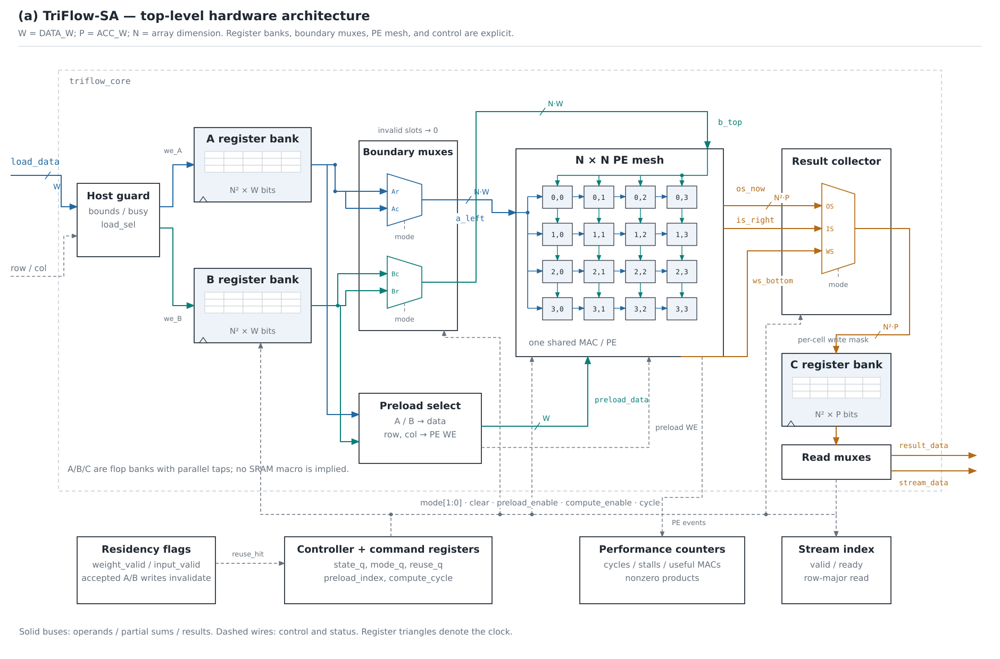

# Architecture and scheduling

The extended core joins two operand register banks, the command controller,
resident tracker, preload sequencer, boundary scheduler, reconfigurable mesh,
result collector/bank, stream sequencer, and event counters. The simple top
wraps that core with the original host ports.

## Physical mappings

For `C[i,j] = sum_k A[i,k] B[k,j]`, each mode maps indices differently:

| Mode | Physical coordinates | Resident value | Boundary injection |
| --- | --- | --- | --- |
| OS | `(i,j)` | Local C accumulator | `A[i,k]` at `t=i+k`; `B[k,j]` at `t=j+k` |
| WS | `(k,j)` | `B[k,j]` | `A[i,k]` at `t=i+k` |
| IS | `(i,k)` | `A[i,k]` | `B[k,j]` at `t=j+k` |

Links are registered. A travels one PE east per enabled compute step; B one
PE south. In WS partial sums travel south, in IS east. Correct operands and
partial sums meet at `t=i+j+k`, with a universal useful-slot mask for physical
coordinates `(r,c)`: `0 <= t-r-c < N`.

The last output completes at `(N−1)+(N−1)+(N−1)`, so compute has `3N−2` steps
including t=0. The collector selects local OS sums, bottom-edge WS sums, or
right-edge IS sums and retires `C[i,j]` when `t=i+j+N−1`. Several cells can
retire on one edge, so the result bank has a per-cell write mask.

## Clear, preload, pause

Clear zeros link/partial-sum/accumulator state and C, preserving resident A/B.
Each cold stationary run directly writes one PE resident register per edge in
row-major order. The corresponding validity flag is set only on its last
write. Host writes invalidate matching residency. A request with reuse enabled
skips preload only when the matching flag is already valid.

Global pause holds the controller cycle/index and suppresses clear, preload,
compute step, useful masks, and retirement. No PE link advances independently
of another, preventing operand/token misalignment. Resume continues at the
same logical time. The independent result streamer is controlled by ready.

## Storage and arithmetic scope

Every PE has separate input and weight resident registers, an OS accumulator,
A/B forwarding registers, and horizontal/vertical partial-sum registers.
The current implementation retains these registers to make dataflow switching
explicit; it does not claim the minimum possible state for a particular mode.
One signed multiplier and one adder are shared through mode muxes.

The A/B/C banks expose parallel taps and use flops with reset. Their total bit
capacity is `N²*(2*DATA_W+ACC_W)`, in addition to PE/link state. This capacity is
not an SRAM area estimate. The host port loads one element per edge. Real
memory banking, bandwidth limits, and DMA are outside this tile-level core.

There is one result bank and no overlapped multi-command compute. The host may
prepare A/B while completed C drains, but it cannot launch compute before a
requested drain ends. Result streaming is full-matrix row-major drain after
computation, rather than a stream of wavefront results during computation.

See [interface.md](interface.md), [pe.md](pe.md), and
[experiments.md](experiments.md) for exact contracts and measurement limits.

## Hardware interconnect and result path

See [array_links.svg](../assets/array_links.svg) for the four registered link
classes and [result_path.svg](../assets/result_path.svg) for C retirement and
read selection. The [figure guide](figures.md) maps schematic state labels to
RTL names and explains the current-sum taps before edge registers.
